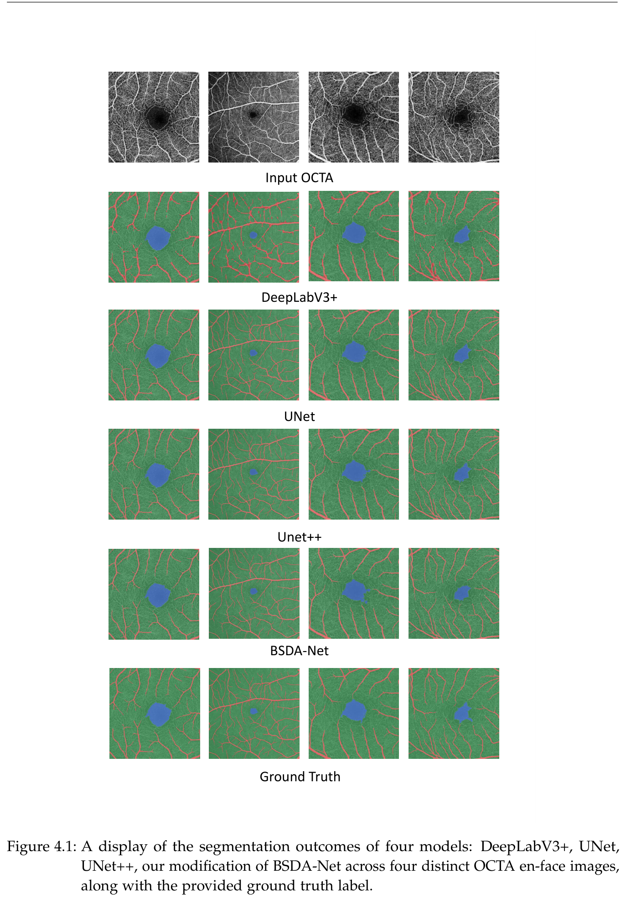

# MultitaskOCTA

**Joint retinal vessel + FAZ segmentation for OCTA-based eye disease classification.**
Master's thesis project, Technische Universität München (Department of Physics — Biomedical Physics), submitted October 2023.

This repository extends [**BSDA-Net**](https://www.researchgate.net/publication/354793161_BSDA-Net_A_Boundary_Shape_and_Distance_Aware_Joint_Learning_Framework_for_Segmenting_and_Classifying_OCTA_Images) (Lin et al., MICCAI 2021) — originally built to jointly segment the Foveal Avascular Zone (FAZ) and classify disease from OCTA (Optical Coherence Tomography Angiography) images — with **retinal vessel segmentation** as a second semantic task, and asks a focused research question: *does teaching the network to see the vasculature, not just the FAZ, actually improve disease classification?*

## Overview

Optical Coherence Tomography Angiography (OCTA) provides non-invasive, capillary-level images of the retinal vasculature. The shape of the FAZ and the morphology of the surrounding vessels are both known to shift with diabetic retinopathy (DR) and age-related macular degeneration (AMD), but most prior work segments only one of the two and rarely measures whether the added segmentation signal actually helps a downstream diagnosis.

This project:
- Integrates the **OCTA-500** dataset's vessel annotations into the BSDA-Net pipeline alongside its existing FAZ annotations, turning it into a joint RV + FAZ segmentation and 3-way (Healthy / DR / AMD) classification model.
- Adds a **clDice** loss term ([Shit et al., CVPR 2021](https://github.com/jocpae/clDice)) to the segmentation objective to preserve vessel topology/connectivity, which plain Dice loss tends to break on thin capillaries.
- Runs a controlled ablation comparing classification performance with **no segmentation** (plain ResNeSt50), **FAZ-only segmentation** (original BSDA-Net), and **joint RV+FAZ segmentation** (this work), to isolate the effect of vascular semantic information on diagnostic accuracy.

<p align="center">
  
  <br>
  <em>Shared encoder with a segmentation decoder (vessel + FAZ) and two auxiliary decoders (boundary heatmap, signed distance map) feeding a joint disease classifier.</em>
</p>

## Results

All numbers below are from 5-fold cross-validation on the OCTA-500 superficial en-face images (see thesis for full discussion).

**Segmentation** (Jaccard / Dice / clDice, %):

| Method | Jaccard | Dice | clDice |
|---|---|---|---|
| DeepLabV3+ | 88.4 ± 2.2 | 92.5 ± 1.6 | 77.6 ± 2.7 |
| UNet | 91.3 ± 1.5 | 97.1 ± 2.5 | 92.3 ± 1.9 |
| UNet++ | 92.2 ± 1.6 | 97.4 ± 2.1 | **93.4 ± 2.5** |
| **BSDA-Net (RV + FAZ, this work)** | **95.3 ± 1.7** | **98.1 ± 1.1** | 91.3 ± 2.4 |

**Classification** (Healthy / DR / AMD, %):

| Method | Accuracy | Precision | Recall | F1 |
|---|---|---|---|---|
| ResNeSt50 (no segmentation) | 89.3 | 87.1 | 88.4 | 87.5 |
| BSDA-Net (FAZ-only seg, original) | 94.1 | 95.4 | 96.2 | 95.3 |
| **BSDA-Net (RV + FAZ, this work)** | **95.2** | 94.7 | 95.6 | **95.4** |

<p align="center">
  
</p>

**Takeaway:** adding vessel segmentation gives the best overall classification numbers, but the gain over FAZ-only BSDA-Net is modest — most of the headroom is eaten up by OCTA-500's small usable label set (364/500 scans) and severe class imbalance, not by the segmentation task itself. See the [Discussion](#full-thesis) section of the thesis for the full analysis.

## Repository structure

```
faz_vessel_seg_cls.py          train / evaluate the joint RV + FAZ segmentation + classification model (this work), one CV fold per call
classification_baseline.py     classification-only ResNeSt50 baseline, same protocol (data, folds, loss weights, metrics)
dataset.py, utils.py           data loading, augmentation (90° rotations + flips), argument parser
losses.py                      Dice, soft-clDice (VesselClDiceLoss) and the multi-task loss
smp_model.py                   encoder / three decoders / classifier definitions (segmentation_models_pytorch based)
eval_metrics.py                per-image Dice, Jaccard, clDice, topology and classification metrics
aggregate_folds.py             mean ± std over folds at each fold's best-validation epoch
plot_runs.py, eval_checkpoint.py, rename_tb_tags.py   curves, re-evaluation of a checkpoint, TensorBoard tag conversion
run_cv.sh, run_sweep.sh        run all folds / compare configurations; sweep_status.sh, summarize_sweep.py
Preprocessing/build_processed_octa500.py   builds the training data from the raw OCTA-500 release
analysis/                      FOV / biomarker baseline, vessel post-processing check
tests/                         unit tests (python -m unittest discover -s tests)
kaggle/                        notebook + bundle script to train on a Kaggle GPU
docs/METHOD.md                 thesis → code map, metric definitions, known deviations  (read this first)
clDice/                        official clDice implementation (MIT)
```

## Setup

```bash
python3.12 -m venv .venv && .venv/bin/pip install -r requirements-lock.txt      # versions verified on Apple Silicon (MPS) and CPU
# Kaggle / Colab: requirements-kaggle.txt (keeps the platform's CUDA torch), see kaggle/README.md
```

The code selects CUDA, then MPS, then CPU (`--device` overrides). **Data:** download OCTA-500 (see [Li et al., 2024](https://ieee-dataport.org/open-access/octa-500); not redistributed here) and build the training set:

```bash
python Preprocessing/build_processed_octa500.py --octa500 <OCTA500> --out Datasets/processed_OCTA500/ILM_OPL_large \
       --projection ILM_OPL --vessel large     # B5 input, GT_FAZ + GT_LargeVessel (thesis setup); 364 scans (Normal / DR / AMD)
```

## Usage

```bash
D=Datasets/processed_OCTA500/ILM_OPL_large
# one fold of the joint model with the thesis hyper-parameters (batch 4, LR 1e-4 / 2e-5, startpoint 20, loss weights 3:1:1)
python faz_vessel_seg_cls.py --img_path $D/image_surface --gt_path $D/gt_full/mask --save_path runs/thesis \
       --train_type Vessel_FAZ --distance_type dist_signed11 --num_epochs 100 --fold 0 --eval_every 3 --full_eval
./run_cv.sh ILM_OPL_large 100 20 _thesis --full_eval          # all five folds in turn
python aggregate_folds.py runs/ILM_OPL_large_thesis           # mean ± std of the test metrics at the best validation epoch
SCRIPT=classification_baseline.py ./run_cv.sh ILM_OPL_large 100 20 _cls --full_eval   # classification-only arm
```

Outputs per run: `results_fold<k>.json` (arguments, git commit, per-image metrics every 3 epochs), `best_fold<k>.pt`, `preds_fold<k>/` (prediction figures), TensorBoard logs (`tensorboard --logdir runs`).
Optional extensions, **off by default** (see `docs/METHOD.md`): `--scheduler onecycle|cosine`, `--vessel_bce`, `--exclusion`, `--aux_channels faz`, `--cldice_alpha`, `--vessel_weight`, `--stratify_fov`, `--bg_dice 0`.

**Reading the numbers.** Segmentation metrics are reported class-wise (FAZ, vessel) per image on the argmax class map, plus `dice_3ch_micro`, the background-dominated micro-average that the original training loop printed as "Dice_Coeff" and that the thesis' segmentation table most likely reports. Do not compare class-wise values with that table. Known confound: 88 % of AMD scans are 6 mm and 64 % of Normal scans 3 mm; report per-FOV and balanced metrics (`balanced_acc`, `recall_*`, `acc_3mm`, `acc_6mm`).

## Full thesis

**"OCTA-based Foveal Avascular Zone (FAZ) and Retinal Vasculature Segmentation and Disease Identification"** — Kourosh Zargari, TUM, October 2023.
Supervisors: Prof. Dr. Julia Herzen, Prof. Dr. Nassir Navab · Advisor: Dr. Shahrooz Faghihroohi.

The full write-up covers the OCT/OCTA imaging background, related work on RV/FAZ segmentation, the complete methodology (loss functions, network design, evaluation metrics), and an in-depth discussion of the results above, including dataset and class-imbalance limitations and directions for future work (unsupervised microvessel segmentation, larger annotated OCTA datasets).

## Citation

If you build on this code, please cite the original BSDA-Net paper and, if you use the vessel segmentation loss, clDice:

```bibtex
@inproceedings{lin2021bsda,
  title={BSDA-Net: A Boundary Shape and Distance Aware Joint Learning Framework for Segmenting and Classifying OCTA Images},
  author={Lin, Li and Wang, Zhonghua and Wu, Jiewei and Huang, Yijin and Lyu, Junyan and Cheng, Pujin and Wu, Jiang and Tang, Xiaoying},
  booktitle={International Conference on Medical Image Computing and Computer-Assisted Intervention},
  year={2021}
}

@inproceedings{cldice2021,
  title={clDice -- a Novel Topology-Preserving Loss Function for Tubular Structure Segmentation},
  author={Shit, Suprosanna and Paetzold, Johannes C and Sekuboyina, Anjany and Ezhov, Ivan and Unger, Alexander and Zhylka, Andrey and Pluim, Josien PW and Bauer, Ulrich and Menze, Bjoern H},
  booktitle={Proceedings of the IEEE/CVF Conference on Computer Vision and Pattern Recognition},
  pages={16560--16569},
  year={2021}
}
```

## Acknowledgements

This work builds directly on [llmir/MultitaskOCTA](https://github.com/llmir/MultitaskOCTA) (BSDA-Net, MICCAI 2021) and the [segmentation_models.pytorch](https://github.com/qubvel/segmentation_models.pytorch) library. Thanks to Prof. Julia Herzen, Prof. Nassir Navab, Dr. Shahrooz Faghihroohi, and Shervin Dehghani for supervision and guidance throughout the thesis.

The base BSDA-Net codebase is shared by its original authors without an explicit license; this fork is shared publicly, with full attribution, for academic/portfolio purposes.
