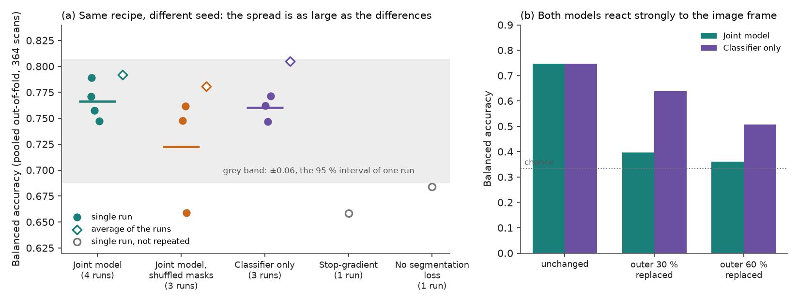
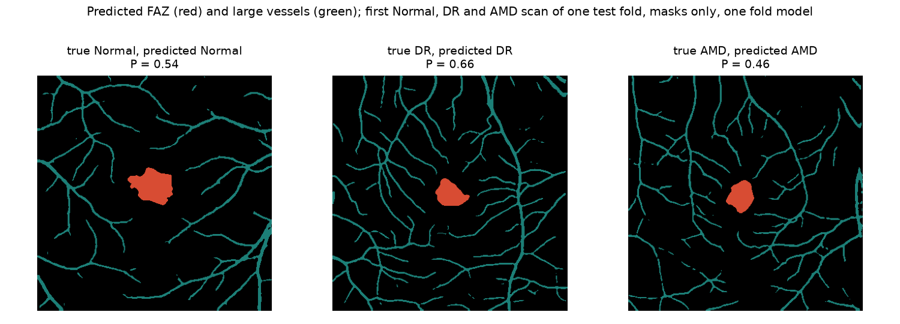
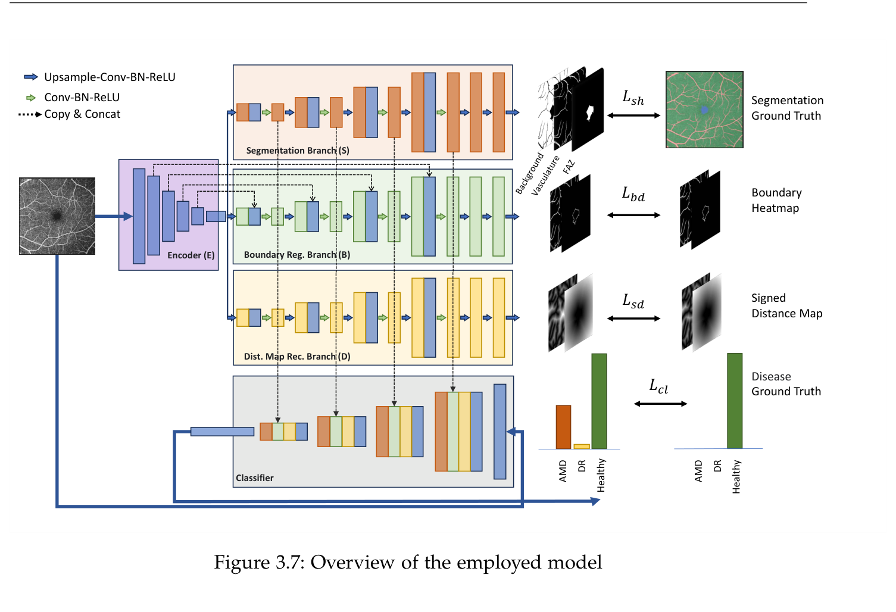

# MultitaskOCTA

[](https://github.com/krshz247/MultitaskOCTA/actions/workflows/tests.yml)
 

**Joint retinal vessel + FAZ segmentation and disease classification on OCTA images: a repaired, tested and re-evaluated version of my Master's thesis code.**
Technische Universität München, Biomedical Physics, 2023. Built on [BSDA-Net](https://www.researchgate.net/publication/354793161_BSDA-Net_A_Boundary_Shape_and_Distance_Aware_Joint_Learning_Framework_for_Segmenting_and_Classifying_OCTA_Images) (Lin et al., MICCAI 2021).

## In short

**Question.** Does teaching a network to segment the foveal avascular zone (FAZ) and the retinal vessels improve its diagnosis of diabetic retinopathy (DR) and age-related macular degeneration (AMD) from OCTA images? The thesis reported 89.3 % accuracy without segmentation and 94.1 % / 95.2 % with FAZ / FAZ + vessel segmentation, and itself noted that the vessel part brought no substantial gain.

**What I did.** I went back to the thesis code, found that its topology loss (clDice) was computed and then silently overwritten, so it never trained, fixed that and several other bugs, rebuilt the data pipeline, and re-tested the question with a leakage-free 5-fold protocol, repeated training runs and uncertainty estimates (bootstrap intervals, power analysis, ablations, attention maps).

**What I found.**
- Segmentation works: FAZ Dice ≈ 0.93 in every run with a 0.5 threshold (0.88 with the stricter 3-class argmax in two of four runs, where the background channel also claims the FAZ pixels), vessel Dice ≈ 0.79, clDice ≈ 0.86.
- Classification reaches 0.75–0.77 balanced accuracy on 364 scans (only 49 AMD). **The segmentation tasks bring no measurable benefit over a plain regularised classifier:** the two agree within the run-to-run spread (about ±0.03). The same model trained on shuffled masks is lower on average under the pipeline's epoch rule (0.72 vs 0.77, four runs each, not significant) and within 0.02 under classification-only epoch rules, so a small effect of the mask content can neither be shown nor excluded. The auxiliary losses behave as a regulariser.
- A single run is not enough to see this: the same recipe gave 0.66 to 0.76 balanced accuracy across seeds.

<p align="center">
  
</p>

<p align="center">
  
</p>

(Figures are drawn from stored results by `analysis/make_figures.py`; they contain no scan images, because the OCTA-500 terms say nothing about publishing images.)

## What is mine

| | |
|---|---|
| From BSDA-Net (Lin et al., 2021) | the joint FAZ-segmentation + classification idea; the three-decoder architecture with boundary heat-map and signed-distance auxiliary tasks |
| Thesis (2023) | vessel segmentation as a second task with OCTA-500 vessel labels; soft-clDice loss; the ablation design |
| This repository | bug fixes in the training objective (disabled clDice term, metrics on rounded logits, unused class weights, off-by-one classifier unfreezing, checkpoint selection); the dataset builder in Python (the MATLAB original was not runnable); class-stratified 5-fold protocol and metrics (Dice, clDice, topology, balanced accuracy, bootstrap, McNemar); seeds, YAML experiment configs, Kaggle GPU runs; the `octa/` package with 33 tests and CI; ablations and analyses (`analysis/`); an inference module and a model card |

## Try it

```bash
python3.12 -m venv .venv && .venv/bin/pip install -r requirements-lock.txt
# put fold0.pt ... fold4.pt and stats.json from the v1.0 release (Releases page) into weights/joint_reg_s1/
.venv/bin/python -m octa.predict predict --weights weights/joint_reg_s1 --image your_scan.bmp --out predictions/
```

Input: a B5 (ILM-OPL) OCTA projection, 3 mm or 6 mm field of view. Output: class probabilities, FAZ and vessel masks, an overlay. Research use only; see `docs/MODEL_CARD.md`.
The data (OCTA-500) are not included; see Setup below.

## Background

Optical Coherence Tomography Angiography (OCTA) provides non-invasive, capillary-level images of the retinal vasculature. The shape of the FAZ and the morphology of the surrounding vessels shift with DR and AMD, but most prior work segments only one of the two and rarely measures whether the added segmentation signal helps the diagnosis.

The model (below) has a shared encoder with three decoders (segmentation of FAZ / vessel / background, boundary heat map, signed-distance map) and a ResNeSt50 classifier that receives the decoder features of all three branches. Training adds a soft-clDice term ([Shit et al., CVPR 2021](https://github.com/jocpae/clDice)) to preserve vessel connectivity. `docs/METHOD.md` maps every element of the thesis to the code.

<p align="center">
  
  <br>
  <em>Shared encoder with a segmentation decoder (vessel + FAZ) and two auxiliary decoders (boundary heatmap, signed distance map) feeding a joint disease classifier.</em>
</p>

## Results in brief

Own results of this implementation, 5-fold cross-validation, B5 projection, 40 epochs per fold, every number on scans the model has not seen. Mean ± sd over runs of the fold-averaged metric; each main recipe was trained three times (one Mac run, Kaggle seeds 1 and 2). The thesis numbers are not used as targets.

| model | runs | accuracy | balanced accuracy | macro-F1 | AMD recall |
|---|---|---|---|---|---|
| joint model, regularised | 3 | 0.788 ± 0.014 | 0.763 ± 0.021 | 0.715 ± 0.016 | 0.73 ± 0.05 |
| joint model, shuffled masks (segmentation supervision meaningless) | 3 | 0.771 ± 0.045 | 0.726 ± 0.052 | 0.690 ± 0.058 | 0.67 ± 0.17 |
| classification-only ResNeSt50, regularised | 3 | 0.819 ± 0.030 | 0.759 ± 0.017 | 0.742 ± 0.032 | 0.63 ± 0.04 |

Segmentation of the joint model: FAZ Dice 0.916 ± 0.025 (3-class argmax; 0.93 with a 0.5 threshold in every run), vessel Dice 0.790 ± 0.004, vessel clDice 0.862 ± 0.004. All tables, the ablations, the epoch-rule comparison and the reading of them: `docs/RESULTS.md`; one-page summary: `docs/SUMMARY_FOR_SUPERVISORS.md`.

**Reading it.**
- The joint model and the plain regularised classifier are equal within the run-to-run spread (pooled balanced accuracy 0.766 vs 0.760 over four and three runs). The shuffled-mask control averages 0.715 over four runs (Welch p = 0.12 against the joint model; the gap is 0.014 and 0.002 under classification-only epoch rules). The stop-gradient and no-segmentation-loss ablations are lower but are single runs and were not repeated.
- Two runs of the same recipe agree on only 79–85 % of the scans, so one run cannot decide any of these comparisons.
- The reported epoch matters: the default selection score uses segmentation metrics, which are meaningless for the shuffled-mask variant, so `docs/RESULTS.md` also gives all variants under one classification-only rule.
- The models do not need the field of view as a shortcut (6 mm scans hold 88 % of the AMD cases), but both change their decisions strongly when the outer part of the scan is replaced by grey, so they are sensitive to the image frame.
- Dense capillary labels make the soft-clDice loss collapse to an all-vessel prediction; the thesis' large-vessel labels do not.

## Repository structure

```
faz_vessel_seg_cls.py          entry point: train / evaluate the joint RV + FAZ segmentation + classification model (this work), one CV fold per call
octa/                          the package behind it: joint_training.py, classification_training.py, config.py (all options), common.py (split, schedules),
                               losses.py, models.py, metrics.py, data/ (dataset, loaders, mask-consistent augmentation)
classification_baseline.py     entry point: classification-only ResNeSt50 baseline, same protocol (data, folds, loss weights, metrics)
aggregate_folds.py             mean ± std over folds at each fold's best-validation epoch
plot_runs.py, eval_checkpoint.py, rename_tb_tags.py   curves, re-evaluation of a checkpoint, TensorBoard tag conversion
run_experiment.py, configs/    run an experiment from a YAML file (all folds, builds the data on demand)
legacy/                        original BSDA-Net scripts and models, the early shell runners and unused preprocessing scripts (not part of the pipeline; see legacy/README.md)
Preprocessing/build_processed_octa500.py   builds the training data from the raw OCTA-500 release
octa/predict.py                inference: image in, class probabilities + FAZ / vessel masks out (docs/MODEL_CARD.md)
analysis/                      one script per question (biomarkers, attention maps, epoch rules, ensembles, power); see analysis/README.md
tests/                         unit tests (python -m unittest discover -s tests)
kaggle/                        notebook + bundle script to train on a Kaggle GPU
docs/METHOD.md                 thesis → code map, metric definitions, known deviations  (read this first)
docs/RESULTS.md                all result tables
docs/SUMMARY_FOR_SUPERVISORS.md, docs/MODEL_CARD.md   findings in one page; what the released model is and is not
octa/third_party/clDice/       vendored clDice implementation (MIT)
```

## Setup

```bash
python3.12 -m venv .venv && .venv/bin/pip install -r requirements-lock.txt      # versions verified on Apple Silicon (MPS) and CPU
# Kaggle / Colab: requirements-kaggle.txt (keeps the platform's CUDA torch), see kaggle/README.md
```

The code selects CUDA, then MPS, then CPU (`--device` overrides). **Data:** download OCTA-500 (see [Li et al., 2024](https://ieee-dataport.org/open-access/octa-500); not redistributed here) and build the training set:

```bash
python Preprocessing/build_processed_octa500.py --octa500 <OCTA500> --out Datasets/processed_OCTA500/ILM_OPL_large \
       --projection ILM_OPL --vessel large     # B5 input, GT_FAZ + GT_LargeVessel (thesis setup); 364 scans (Normal / DR / AMD)
```

## Usage

```bash
python run_experiment.py configs/joint_cv40.yaml          # 5 folds of the joint model; builds the dataset if missing, saves config.yaml + git commit
python run_experiment.py configs/classification_baseline.yaml --folds 0 1 --dry-run   # see configs/README.md for all experiments
```

The same experiment by hand:

```bash
D=Datasets/processed_OCTA500/ILM_OPL_large
# one fold of the joint model with the thesis hyper-parameters (batch 4, LR 1e-4 / 2e-5, startpoint 20, loss weights 3:1:1)
python faz_vessel_seg_cls.py --img_path $D/image_surface --gt_path $D/gt_full/mask --save_path runs/thesis \
       --train_type Vessel_FAZ --distance_type dist_signed11 --num_epochs 100 --fold 0 --eval_every 3 --full_eval
python run_experiment.py configs/joint_thesis.yaml            # all five folds in turn (100 epochs, thesis settings)
python aggregate_folds.py runs/joint_thesis100              # mean ± std of the test metrics at the best validation epoch
python run_experiment.py configs/classification_baseline.yaml # classification-only arm, same protocol
```

Outputs per run: `results_fold<k>.json` (arguments, git commit, per-image metrics every 3 epochs), `best_fold<k>.pt`, `preds_fold<k>/` (prediction figures), TensorBoard logs (`tensorboard --logdir runs`).
Optional extensions, **off by default** (see `docs/METHOD.md`): `--scheduler onecycle|cosine`, `--vessel_bce`, `--exclusion`, `--aux_channels faz`, `--cldice_alpha`, `--vessel_weight`, `--stratify_fov`, `--bg_dice 0`.

**Reading the numbers.** Segmentation metrics are reported class-wise (FAZ, vessel) per image on the argmax class map, plus `dice_3ch_micro`, the background-dominated micro-average that the original training loop printed as "Dice_Coeff" and that the thesis' segmentation table most likely reports. Do not compare class-wise values with that table. Known confound: 88 % of AMD scans are 6 mm and 64 % of Normal scans 3 mm; report per-FOV and balanced metrics (`balanced_acc`, `recall_*`, `acc_3mm`, `acc_6mm`).

## Tests

```bash
python -m unittest discover -s tests            # 33 tests: fast unit tests + golden regression (the golden trainings take several minutes on a CPU)
SKIP_SLOW_TESTS=1 python -m unittest discover -s tests   # unit tests only (seconds)
python tests/verify_checkpoints.py              # re-evaluates stored checkpoints (needs the local runs/ and Datasets/)
```
`tests/test_golden.py` trains tiny models for 2 epochs on a synthetic data set and compares every metric with `tests/golden/*.json`; on one machine the result is bit-for-bit reproducible, so any change of behaviour is detected (`GOLDEN_TOL=1e-9`). A GitHub Actions workflow (`.github/workflows/tests.yml`) runs pyflakes and the unit tests.

## Prediction with trained weights

```bash
python -m octa.predict predict --weights weights/joint_reg_s1 --image scan.bmp --out predictions/     # class probabilities, FAZ / vessel overlay
```
Weights: see `docs/MODEL_CARD.md` (research use only; not a medical device).

## Future work (not done here)
Swap the encoder for ConvNeXt or a ViT and check vessel connectivity (clDice); self-supervised pretraining on the unused OCTA-500 scans; deeper projections or the 3D volumes for AMD; repeats of the stop-gradient and no-segmentation-loss ablations; one classification-only checkpoint rule for all variants.

## Full thesis

**"OCTA-based Foveal Avascular Zone (FAZ) and Retinal Vasculature Segmentation and Disease Identification"** — Kourosh Zargari, TUM, October 2023.
Supervisors: Prof. Dr. Julia Herzen, Prof. Dr. Nassir Navab · Advisor: Dr. Shahrooz Faghihroohi.

The full write-up covers the OCT/OCTA imaging background, related work on RV/FAZ segmentation, the complete methodology (loss functions, network design, evaluation metrics), and an in-depth discussion of the results above, including dataset and class-imbalance limitations and directions for future work (unsupervised microvessel segmentation, larger annotated OCTA datasets).

## Citation

If you build on this code, please cite the original BSDA-Net paper, clDice if you use the vessel segmentation loss, and the OCTA-500 dataset (its page on IEEE DataPort asks users to cite at least one of the papers listed there; please check that list):

```bibtex
@inproceedings{lin2021bsda,
  title={BSDA-Net: A Boundary Shape and Distance Aware Joint Learning Framework for Segmenting and Classifying OCTA Images},
  author={Lin, Li and Wang, Zhonghua and Wu, Jiewei and Huang, Yijin and Lyu, Junyan and Cheng, Pujin and Wu, Jiang and Tang, Xiaoying},
  booktitle={International Conference on Medical Image Computing and Computer-Assisted Intervention},
  year={2021}
}

@inproceedings{cldice2021,
  title={clDice -- a Novel Topology-Preserving Loss Function for Tubular Structure Segmentation},
  author={Shit, Suprosanna and Paetzold, Johannes C and Sekuboyina, Anjany and Ezhov, Ivan and Unger, Alexander and Zhylka, Andrey and Pluim, Josien PW and Bauer, Ulrich and Menze, Bjoern H},
  booktitle={Proceedings of the IEEE/CVF Conference on Computer Vision and Pattern Recognition},
  pages={16560--16569},
  year={2021}
}

@article{li2024octa500,
  title={OCTA-500: A retinal dataset for optical coherence tomography angiography study},
  author={Li, Mingchao and Huang, Kun and Xu, Qiuzhuo and Yang, Jiadong and Zhang, Yuhan and Ji, Zexuan and Xie, Keren and Yuan, Songtao and Liu, Qinghuai and Chen, Qiang},
  journal={Medical Image Analysis},
  volume={93},
  pages={103092},
  year={2024},
  doi={10.1016/j.media.2024.103092}
}
```

## Acknowledgements

This work builds directly on [llmir/MultitaskOCTA](https://github.com/llmir/MultitaskOCTA) (BSDA-Net, MICCAI 2021) and the [segmentation_models.pytorch](https://github.com/qubvel/segmentation_models.pytorch) library. Thanks to Prof. Julia Herzen, Prof. Nassir Navab, Dr. Shahrooz Faghihroohi, and Shervin Dehghani for supervision and guidance throughout the thesis.

## Licence

No licence is granted: this is research code, shared publicly with full attribution for academic and portfolio purposes. The base BSDA-Net code from its original authors has no explicit licence either; the vendored `octa/third_party/clDice/` folder is MIT-licensed.
